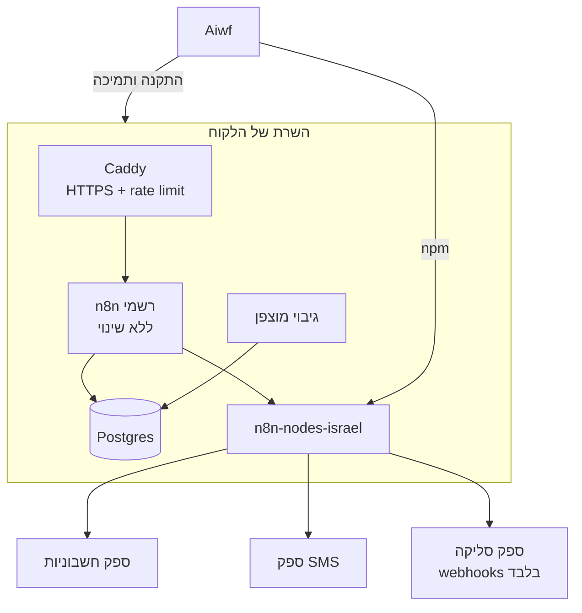

# Aiwf MVP: מודל שירות (אפשרות 3)

סטטוס: **טיוטת אפיון לאישור**. עדיין לא נכתב קוד.

## 1. סיכום

Aiwf הוא **שירות**, לא מוצר שמארח את n8n.
הלקוח מחזיק את n8n משלו, ו־Aiwf מוכר ארבעה רכיבים שנמצאים בבעלותו המלאה:

| רכיב | מה זה | בעלות ורישיון |
|---|---|---|
| 1. `n8n-nodes-israel` | חבילת Community Nodes לשירותים ישראליים | קוד שלך. רישיון לבחירתך (MIT להפצה רחבה, או קנייני) |
| 2. `aiwf-deploy` | ערכת פריסה מאובטחת ל־n8n אצל הלקוח | קוד שלך |
| 3. `aiwf-templates` | ספריית workflows (JSON) לעסקים בישראל | יצירה שלך |
| 4. שירות | הקמה, התאמה ותמיכה בריטיינר | חוזה שירות |

n8n עצמו נשאר ללא שינוי, ומותקן אצל הלקוח לשימוש העסקי הפנימי שלו.



## 2. הנחות עבודה (לתקן אם לא נכון)

1. אין עדיין תשובה לשאלה אילו שירותים קודם. **הנחה:** MVP עם ספק חשבוניות אחד, ספק SMS אחד וקבלת webhooks מספק סליקה אחד.
2. **הנחה לבחירת ספקים:** חשבונית ירוקה/Morning, ספק SMS ישראלי אחד, ו־Cardcom או Tranzila. הבחירה הסופית תלויה בתיעוד API ציבורי וב־sandbox זמין. **דורש אימות מול התיעוד הרשמי של כל ספק.**
3. הלקוחות הם עסקים קטנים ובינוניים בישראל, עם שרת VPS או Docker.
4. ה־repos החדשים נפתחים בנפרד מ־Aiwf. אין לי הרשאה ליצור repos, אז אתה תפתח אותם.
5. ה־repo הזה (`Aiwf`) נשאר מראה של n8n לבדיקות, ומכיל רק את `docs/aiwf/`.

## 3. User Stories

**בעל עסק (הלקוח):**
- כבעל עסק, אני רוצה שכל ליד מהאתר ייכנס ל־CRM ויקבל הודעת WhatsApp או SMS תוך דקה.
- כבעל עסק, אני רוצה שאחרי תשלום מוצלח תופק חשבונית ותישלח ללקוח אוטומטית.
- כבעל עסק, אני רוצה גיבוי יומי, ולדעת שהמידע שלי נשאר בשרת שלי.

**Aiwf (אתה):**
- כמקים, אני רוצה להתקין n8n מאובטח אצל לקוח חדש בפחות מ־30 דקות, בפקודה אחת.
- כמקים, אני רוצה לייבא workflow מוכן ולהזין רק credentials.
- כמתחזק, אני רוצה לעדכן גרסת n8n או גרסת חבילה אצל לקוח, עם אפשרות rollback.

## 4. רכיב 1: `n8n-nodes-israel`

### טכנולוגיה

- נוצר עם הכלי הרשמי `npm create @n8n/node@latest`. הכלי קיים בריפו הזה תחת `packages/@n8n/create-node` ו־`packages/@n8n/node-cli`.
- פקודות הפיתוח: `n8n-node dev`, `n8n-node build`, `n8n-node lint`, `n8n-node release`.
- TypeScript, nodes מסוג **declarative** כשאפשר: פחות קוד ופחות באגים. **programmatic** רק כשצריך לוגיקה, למשל אימות חתימת webhook.
- **חלופות:** node אחד גדול עם כל הספקים (קל לתחזוקה אבל כבד), או חבילה נפרדת לכל ספק (גמיש אבל יותר עבודת release). **המלצה:** חבילה אחת עם node נפרד לכל ספק.

### מבנה תיקיות מוצע

```text
n8n-nodes-israel/
├── credentials/
│   ├── InvoiceProviderApi.credentials.ts
│   └── SmsProviderApi.credentials.ts
├── nodes/
│   ├── InvoiceProvider/
│   │   ├── InvoiceProvider.node.ts
│   │   ├── InvoiceProvider.node.json      # codex: categories
│   │   └── icon.svg
│   ├── SmsProvider/
│   └── PaymentWebhookTrigger/            # verifies signatures
├── test/                                 # vitest, mocked HTTP only
├── .env.example                          # sandbox keys placeholders only
├── README.md                             # Hebrew + English
├── CHANGELOG.md
└── package.json
```

### פעולות MVP (לאימות מול ה־API של כל ספק)

| Node | פעולות |
|---|---|
| Invoice | יצירת מסמך (חשבונית מס/קבלה), שליפת מסמך, חיפוש לקוח |
| SMS | שליחת הודעה, בדיקת סטטוס |
| Payment Trigger | קבלת אירוע תשלום, אימות חתימה או מקור, החזרת נתוני עסקה **ללא פרטי כרטיס** |

## 5. רכיב 2: `aiwf-deploy`

```text
aiwf-deploy/
├── compose.yml          # n8n + postgres + caddy + backup
├── Caddyfile            # HTTPS, security headers, rate limit on /webhook
├── .env.example         # no real secrets
├── scripts/
│   ├── install.sh       # generates secrets locally, never prints them
│   ├── backup.sh        # pg_dump, then encrypt, then rotate
│   ├── restore.sh
│   └── upgrade.sh       # pin version, backup first, rollback on failure
├── HARDENING.md         # checklist
└── README.md
```

עקרונות:
- גרסת n8n ננעלת לגרסה מדויקת. לא משתמשים ב־`latest`.
- `N8N_ENCRYPTION_KEY` נוצר בהתקנה ונשמר רק אצל הלקוח. צריך להנחות את הלקוח לגבות אותו: בלעדיו ה־credentials אבודים.
- Postgres לא חשוף החוצה. רק Caddy מאזין ל־443.
- את רשימת משתני הסביבה של אבטחה ב־n8n אאמת מול `packages/@n8n/config` בגרסה הנעולה, לפני הכתיבה.

## 6. רכיב 3: `aiwf-templates`

MVP של 3 תבניות:
1. ליד מטופס, ל־CRM, ל־SMS או WhatsApp ללקוח, והתראה לבעל העסק.
2. תשלום מוצלח, הפקת חשבונית ושליחתה במייל.
3. תזכורת לתור 24 שעות מראש ב־SMS, עם קישור לביטול.

כל תבנית כוללת README בעברית, רשימת credentials נדרשים, ובלוק Data Map (ראה סעיף 8).

## 7. Threat Model

| נכס | איום | בקרה |
|---|---|---|
| API keys של לקוחות | דליפה דרך לוגים, repo או צילום מסך | Credentials מוצפנים של n8n בלבד. אין סודות ב־workflows או בתבניות. secret scanning ב־CI |
| Webhooks ציבוריים | בקשות מזויפות, הצפה | אימות חתימה ב־Trigger, rate limit ב־Caddy, הגבלת גודל payload |
| פרטי תשלום | עיבוד פרטי כרטיס בשרת הלקוח | הכרטיס לא נוגע ב־n8n. רק דף סליקה מתארח אצל הספק, ו־webhook עם מזהה עסקה. **דורש בדיקת PCI DSS** |
| n8n UI | ניחוש סיסמה, גישה לא מורשית | HTTPS בלבד, MFA של n8n לבעלים, IP allowlist אופציונלי ב־Caddy |
| גיבויים | גניבת קובץ dump | הצפנה לפני העלאה, מפתח נפרד מהשרת, מחיקה לפי retention |
| שרשרת אספקה | חבילת npm זדונית או פרוצה | lockfile, `npm audit`, פרסום עם 2FA ו־provenance, מעט תלויות |
| עדכוני n8n | גרסה חדשה שוברת workflows | גרסה נעולה, גיבוי לפני עדכון, סקריפט rollback |

## 8. פרטיות: Data Map בסיסי (לכל תבנית)

| סוג מידע | מקור | מטרה | אחסון | צד שלישי | שמירה |
|---|---|---|---|---|---|
| שם, טלפון, מייל של ליד | טופס באתר | יצירת קשר | Postgres אצל הלקוח, CRM | ספק SMS, CRM | לפי מדיניות הלקוח (מוצע: 24 חודשים) |
| פרטי חשבונית | אירוע תשלום | חובה חוקית (מס) | ספק החשבוניות | ספק החשבוניות | לפי דיני מס. **דורש בדיקה** |
| היסטוריית הרצות n8n | n8n | דיבאג | Postgres | אין | מוצע: לצמצם עם `EXECUTIONS_DATA_PRUNE`. **לאמת את שם המשתנה** |

הלקוח הוא בעל המאגר. Aiwf הוא ככל הנראה **מחזיק או ספק** לפי חוק הגנת הפרטיות ותיקון 13.
נדרש הסכם עיבוד מידע (DPA) בין Aiwf ללקוח. **דורש בדיקה משפטית.**

## 9. תוכנית שלבים

| שלב | תוצר | תנאי מעבר |
|---|---|---|
| 0 | אישור האפיון, בחירת 3 ספקים ופתיחת repos | אישור שלך |
| 1 | `aiwf-deploy`: התקנה, גיבוי, שחזור, עדכון | התקנה נקייה על VPS בדיקות, ושחזור מגיבוי עובד |
| 2 | `n8n-nodes-israel` v0.1: SMS node | בדיקות יחידה, lint של `n8n-node`, הרצה מול sandbox |
| 3 | v0.2: Invoice node ו־Payment Trigger | בדיקה מקצה לקצה ב־sandbox |
| 4 | `aiwf-templates`: 3 תבניות | ייבוא נקי ל־n8n חדש והרצה מוצלחת |
| 5 | חבילה מסחרית: הצעת מחיר, חוזה שירות, DPA ו־SLA | בדיקת עו"ד |

## 10. סיכונים ונושאים לבדיקה מקצועית

- **רישיון n8n:** אסור ש־Aiwf יארח את n8n עבור הלקוח בתשלום. אם הלקוח ירצה שתארח אצלך, זה אזור אפור. **עו"ד.**
- **APIs של ספקים:** תנאי שימוש, הגבלות קצב, ו־sandbox זמין. חלק מהספקים לא מאפשרים חבילה ציבורית בלי הסכם. **לאמת מול כל ספק.**
- **סימן מסחרי:** מותר לכתוב "for n8n", אבל השם n8n לא יכול להופיע כחלק מהמותג שלך. **עו"ד.**
- **פרטיות:** DPA, תיקון 13, ושליחת SMS שיווקי לפי חוק התקשורת (חוק הספאם). **עו"ד.**
- **סליקה:** PCI DSS. **בודק מוסמך** אם יש שינוי בזרימה.

## 11. החלטות פתוחות

1. אילו 3 ספקים בדיוק (חשבוניות, SMS, סליקה)?
2. רישיון החבילה: MIT ציבורי ב־npm, או קנייני ופרטי ללקוחות בלבד?
3. שם המותג וה־scope ב־npm (למשל `@aiwf/n8n-nodes-israel`)?
4. להתחיל משלב 1 (פריסה) או משלב 2 (nodes)? **המלצה:** שלב 1. הוא מהיר, ונדרש לכל לקוח.
