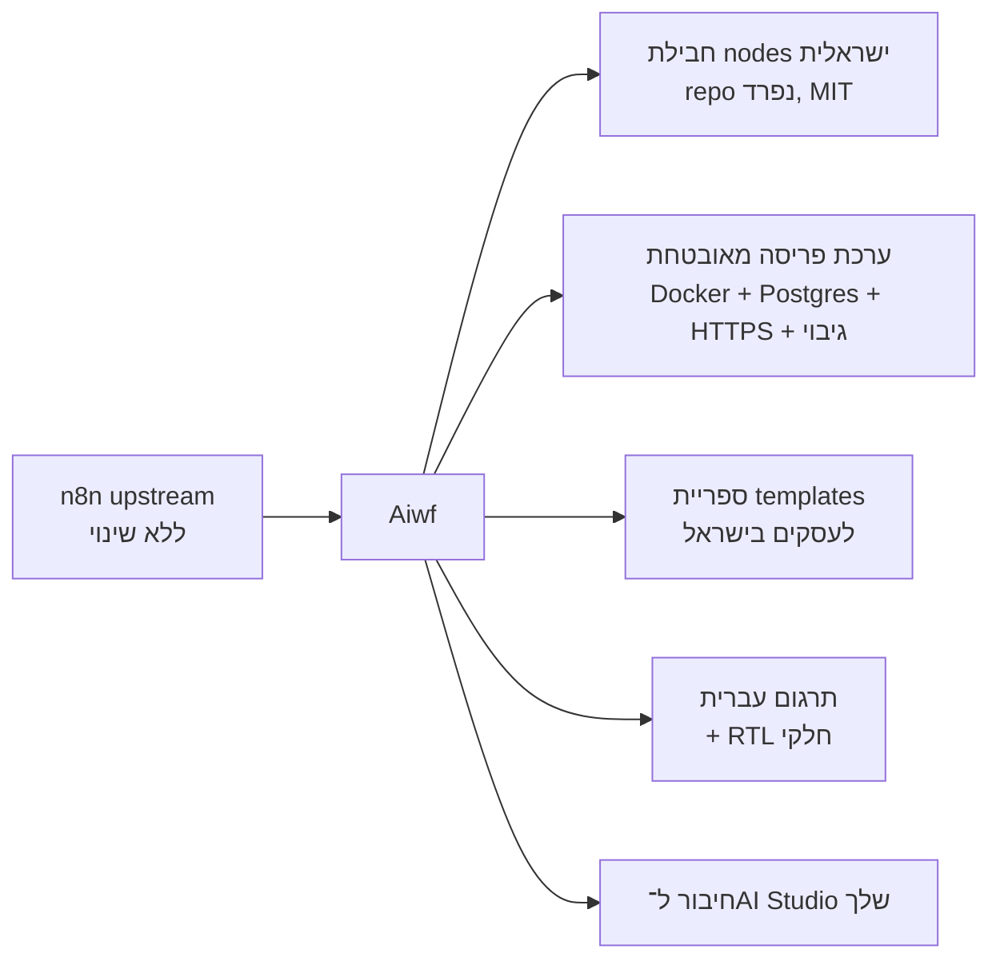

# Aiwf: דוח סריקה והמלצות לשדרוג וגיוון

תאריך: 2026-11-10 · ענף: `claude/friendly-gauss-36aczd`

## 1. מה נמצא בסריקה

| בדיקה | ממצא |
|---|---|
| מקור הקוד | העתק 1:1 של `n8n-io/n8n` (master, גרסה `2.48.0`) |
| שינויים שלך | **אין**. כל 50 הקומיטים הם של צוות n8n. הענף זהה ל־`master` |
| היסטוריה | clone רדוד (50 קומיטים), ללא remote ל־upstream |
| תרגום | יש רק `en.json` (11,115 שורות). **אין עברית** |
| RTL | אין תמיכה ב־RTL ב־frontend (אין `dir="rtl"` ואין סגנונות RTL) |
| Nodes | 308 nodes. יש WhatsApp ו־Monday. **אין** nodes לשירותים ישראליים (חשבוניות, סליקה, SMS) |
| CI | 109 GitHub workflows של n8n. ב־fork רובם ייכשלו (חסרים secrets) או יבזבזו דקות Actions |
| רישיון | Sustainable Use License, וקבצי `.ee.` דורשים רישיון Enterprise |

**מסקנה:** אין כאן עדיין קוד שלך לשדרג. שדרוג ליבת n8n ב־fork יוצר קונפליקטים בכל סנכרון.
הערך נמצא **בשכבה מעל n8n**, לא בתוכו.

## 2. חסם ראשון: רישיון (דורש בדיקה משפטית)

לפי `LICENSE.md`:

- מותר: שימוש פנימי בעסק, שימוש אישי ולא־מסחרי, והפצה ללא תשלום למטרות לא־מסחריות.
- אסור: למכור את n8n כשירות מתארח (SaaS) ללקוחות, או לעשות לו white-label ולמכור אותו.
- קבצי `.ee.` (SSO, Source Control, Environments ועוד): אסור להשתמש בהם ללא רישיון Enterprise.
- בניית workflows ללקוחות כשירות ייעוץ מותרת לפי ה־FAQ של n8n. **דורש אימות מול התיעוד הרשמי ובדיקה משפטית.**

לכן חשוב להחליט קודם מה המטרה של ה־fork (ראה שאלות בסעיף 6).

## 3. כיווני שדרוג וגיוון מומלצים



| # | כיוון | ערך | מאמץ | סיכון קונפליקט עם upstream | המלצה |
|---|---|---|---|---|---|
| A | **חבילת Community Nodes ישראלית** (`n8n-nodes-israel`): חשבונית ירוקה/Morning, iCount, Cardcom, Tranzila, ספקי SMS ישראליים | גבוה: אין מתחרים רבים, אפשר להפיץ או למכור | בינוני | אפס (repo נפרד) | **עדיפות 1** |
| B | **ערכת פריסה לפרודקשן**: Docker Compose עם Postgres, Caddy/Traefik ל־HTTPS, גיבויים, `N8N_ENCRYPTION_KEY` מנוהל, כותרות אבטחה, צ'קליסט hardening | גבוה לכל התקנה ללקוח | נמוך | אפס | **עדיפות 1** |
| C | **ספריית Templates** (JSON): ליד → CRM → WhatsApp, הפקת חשבונית אחרי תשלום, תזכורות לתורים | בינוני־גבוה, מכירה מהירה | נמוך | אפס | עדיפות 2 |
| D | **תרגום לעברית** (`he.json`) דרך `N8N_DEFAULT_LOCALE` | בינוני | גבוה (כ־11 אלף מחרוזות) | נמוך (קובץ חדש) | עדיפות 3. RTL מלא בקנבס לא מומלץ: הוא נוגע בהרבה קבצי ליבה |
| E | **חיבור ל־AI Studio שלך** דרך node מותאם או MCP | תלוי במוצר | בינוני | אפס | לבירור |

### מה לא לעשות

- לא לשנות קבצים בליבה (`packages/cli`, `packages/core`, `editor-ui`) אלא אם אין ברירה.
- לא להסיר את סימני n8n ואת הרישיון.
- לא להשתמש בקבצי `.ee.` ללא רישיון.

## 4. תחזוקת ה־fork (מומלץ מיד)

1. **לכבות או לצמצם GitHub Actions** ב־fork (Settings → Actions). 109 workflows ירוצו על כל push.
2. **להוסיף remote ל־upstream** ולסנכרן את `master` בלבד:
   ```bash
   git remote add upstream https://github.com/n8n-io/n8n.git
   git fetch upstream master
   git merge --ff-only upstream/master
   ```
3. לשמור `master` זהה ל־upstream. עבודה שלך נכנסת ל־repos נפרדים (כיוונים A–C) או לתיקייה `docs/aiwf/`.

## 5. אבטחה ופרטיות (לכל כיוון)

- Threat model ל־nodes: מפתחות API של לקוחות נשמרים כ־Credentials מוצפנים של n8n בלבד. לא ב־env, לא בלוגים.
- סליקה (Cardcom/Tranzila): לא לעבור דרך n8n עם פרטי כרטיס. רק tokens ו־webhooks חתומים. **דורש בדיקת PCI.**
- Webhooks: אימות חתימה, rate limiting ב־reverse proxy, הגבלת payload.
- פרטיות: nodes שמעבירים מידע אישי לספקים צד שלישי. נדרש Data Map לכל לקוח, ובדיקה מול חוק הגנת הפרטיות ותיקון 13. **דורש בדיקה משפטית.**
- פריסה: HTTPS בלבד, `N8N_SECURE_COOKIE=true`, Postgres במקום SQLite, גיבוי מוצפן, עדכוני גרסה קבועים.

## 6. שאלות הבהרה (לפני בנייה)

1. מה המטרה של Aiwf: שימוש פנימי בעסק שלך, שירות הקמת אוטומציות ללקוחות, או מוצר SaaS? (משפיע ישירות על הרישיון)
2. איזה כיוון להתחיל: A (nodes ישראליים), B (ערכת פריסה), C (templates), D (עברית)?
3. אם A: אילו שירותים קודם? (חשבונית ירוקה/Morning, iCount, Cardcom, Tranzila, SMS, אחר)
4. איפה מארחים? (VPS, Docker מקומי, ענן)
5. האם לשלב את AI Studio שלך, ואיך הוא חשוף (REST API, MCP)?

## 7. הצעד הבא המומלץ

לאשר כיוון אחד. אחרי האישור אכין אפיון MVP בקובץ MD נפרד: User Stories, ארכיטקטורה, מבנה תיקיות,
Threat Model ותוכנית שלבים. רק אחרי אישור האפיון אכתוב קוד.
